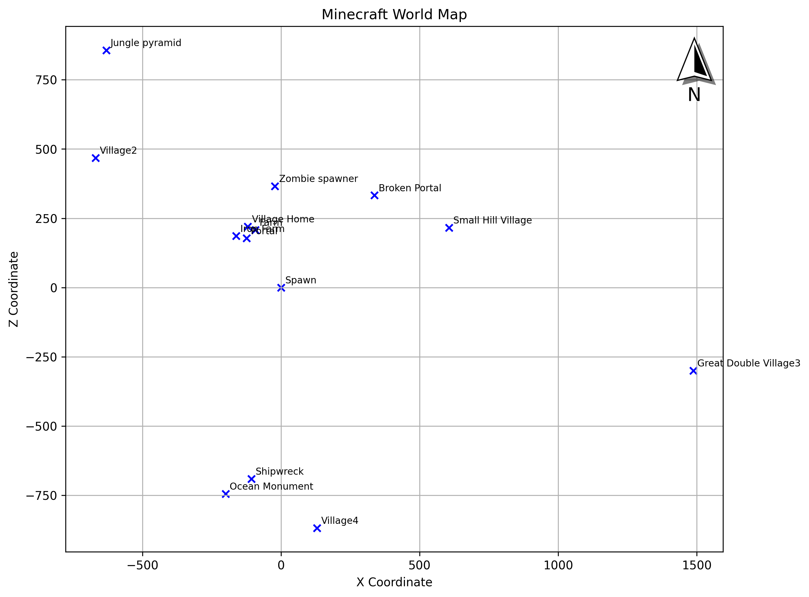

# Minecraft Map

Create a simple Minecraft schematic map from your notes.

## Usage:

This is a sample game's coordinates notes:
```markdown
# home area
Spawn: 0 / 0 / 0
Village Home: -120 / 94 / -220
Portal: -124 / 85 / -178

# mines
Zombie spawner: -22  / 23 / -366

# my first sea trip
Underwater Village: -231 / 62 / 339
Underwater Village2: 90 / 62 / 712
Shipwreck: -632 / 62 / 476
Outpost: -882 / 62 / 272
Underwater sand Village: -549 / 62 / 83
Underwater Portal: -326 / 62 / 106
```

After running `./mimap.py` you get this:
<center></center>

Run with your own notes using uv:

```bash
./mimap.py notes.md             # Interactive map; close the window to stop
./mimap.py notes.md output.png  # Save PNG once and exit
./mimap.py "*" output.png       # Render sample data once
```

Only interactive Matplotlib maps watch input files. Files are checked every
500 ms and reloaded after two identical reads. Sample data is not watched.
The interactive map keeps your zoom and position; Home fits all current locations.
If the input temporarily disappears or contains no valid coordinates, the last
valid map remains visible until the input is fixed. Invalid lines are skipped
with a warning as usual.

PNG export renders the input once, replaces the output file atomically, and
exits without watching for changes. Run the command again to update the PNG.

# TODO
Usage improvements:
- [ ] output filename based on input file name, or some sane default for sample data
- [ ] doc install & run using uv
- [ ] dynamic `LABEL_OFFSET`
